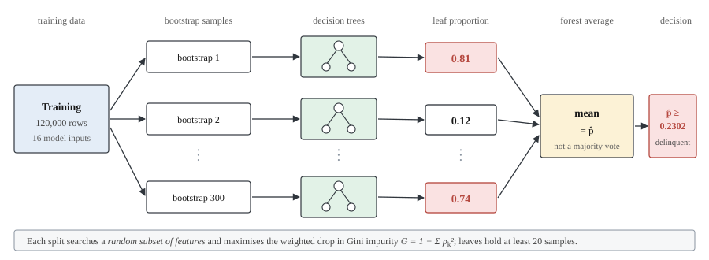
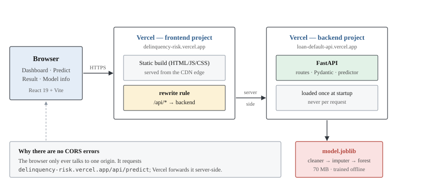

# Overview

## What this is

A supervised binary classifier that estimates the probability a borrower
experiences **serious delinquency — 90 days past due or worse — within two
years** of an observation date, trained on the public Kaggle *Give Me Some
Credit* dataset and served through a web application.

It is **classification**, not regression (the output is a category, not a
quantity) and not clustering (the groups come from labels). The defining
property of the problem is **class imbalance**: only 6.68% of borrowers are
positive, which shapes every evaluation decision in this documentation.

> **Scope.** Educational coursework. Not a credit-underwriting system, and not
> fit to approve, decline or price real credit. See
> [Limitations](09-limitations.md).

## Headline results

Measured on a 30,000-row held-out test split, scored exactly once, at the
validation-selected threshold of 0.2302.

| Metric | Value | Read it as |
|---|---:|---|
| **ROC-AUC** | **0.8654** | Ranks a delinquent borrower above a sound one 86.5% of the time |
| **PR-AUC** | **0.4014** | ~6× the no-skill baseline of 0.0668 |
| Recall | 0.4868 | Caught 976 of 2,005 real delinquencies |
| Precision | 0.4153 | Of those flagged, 42% truly were |
| F1 | 0.4482 | Positive class |
| Accuracy | 0.9199 | **Lower** than always answering "no" (0.9332) |

That last row is the point, not a defect: accuracy is a misleading headline
when one class is rare. Five-fold cross-validation puts ROC-AUC at
0.8632 ± 0.0053, with the test value inside one standard deviation — the score
is stable, not a lucky split. Full detail in
[Model evaluation](05-model-evaluation.md).

## How a prediction is made

300 decision trees are grown on bootstrap samples, each split searching a
random subset of features. For a new borrower, every tree reports the positive
proportion of the leaf that borrower lands in, and the forest **averages**
those proportions. That mean is the predicted probability — scikit-learn
averages per-tree probabilities rather than taking a hard majority vote. The
probability is then compared with the decision threshold to produce a class.

## How the pieces fit

| Piece | Role |
|---|---|
| `backend/ml/` | Offline: inspect, train, evaluate, write the artifact |
| `backend/app/` | FastAPI service that loads the artifact once and scores requests |
| `frontend/` | Four-page React app: Dashboard, Predict, Result, Model info |
| `model.joblib` | The fitted pipeline — cleaner, imputer and forest in one object |

Preprocessing lives *inside* the saved pipeline, so inference cannot apply a
different transformation from training. See [Architecture](06-architecture.md).

## Technology

| Layer | Stack |
|---|---|
| Model | scikit-learn `RandomForestClassifier`, joblib |
| Data | pandas, NumPy; matplotlib and seaborn for figures |
| API | FastAPI, Pydantic v2, Uvicorn |
| Frontend | React 19, Vite, TypeScript, Tailwind CSS v4, React Router |
| Tests | pytest — 61 tests |

## What to read next

- Getting it running: [Setup](02-setup.md)
- Where the data came from and what was wrong with it: [Dataset](03-dataset.md)
- How the model was chosen: [Methodology](04-methodology.md)
- What the numbers mean: [Model evaluation](05-model-evaluation.md)
