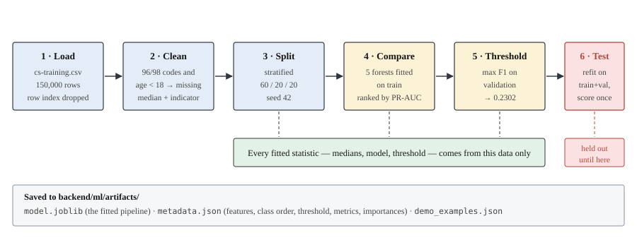
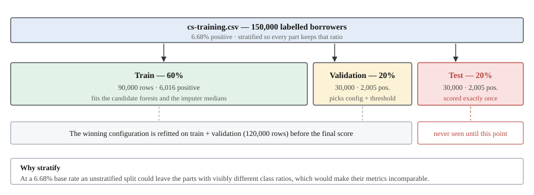

# Methodology

How the data is prepared and the model is fitted. Every decision below is
implemented in `backend/ml/` and reproducible with a fixed seed.

## Reproducibility

- Seed: **42**, used for both the splits and the forests
  (`backend/ml/splits.py`, `RANDOM_SEED`).
- Re-running `python -m ml.train` on the same `cs-training.csv` reproduces the
  same splits, the same model and the same metrics.
- The raw CSV is only ever read, never written. All derived output goes to
  `backend/ml/artifacts/`.

## Pipeline



Preprocessing and the classifier live in one scikit-learn `Pipeline`
(`backend/ml/preprocessing.py`), which is what gets saved with `joblib`:

```
ImplausibleValueCleaner
  →  SimpleImputer(strategy="median", add_indicator=True)
  →  RandomForestClassifier
```

Keeping the transformations *inside* the pipeline is the main defence against
train/serve skew: the API loads this object and calls it, so inference cannot
apply a different imputation than training did. There is no second copy of the
preprocessing logic on the serving side.

All ten predictors are numeric, so one imputer covers them, and a Random Forest
needs neither scaling nor encoding. Nothing else was added.

## Splitting



Stratified 60 / 20 / 20 into train / validation / test
(`backend/ml/splits.py`):

| Split | Rows | Positive | Positive rate |
|---|---:|---:|---:|
| Train | 90,000 | 6,016 | 6.68% |
| Validation | 30,000 | 2,005 | 6.68% |
| Test | 30,000 | 2,005 | 6.68% |

Stratification matters at a 6.68% base rate: an unstratified split could leave
the parts with visibly different base rates, making their metrics
incomparable.

**Fitting order.** Candidate models are fitted on the training split only and
compared on validation. The chosen configuration is then refitted on
train + validation (120,000 rows) and scored **once** on the test split. The
test rows take no part in imputation statistics, model selection or
hyperparameter choice.

**The competition's `cs-test.csv` is never used.** Its target column is empty,
so no metric could honestly be computed on it.

## Cleaning decisions

### Columns removed

| Column | Reason |
|---|---|
| `Unnamed: 0` | The CSV's row number. It is an artifact of the file, correlates with nothing, and would be pure noise (or worse, a spurious ordering signal) as a model input. |

Nothing else is dropped. The target is excluded from the inputs structurally:
`split_features_and_target` selects the predictor list by name rather than
dropping the label from the frame, so a column can only reach the model if it
is on the explicit `FEATURES` list.

### Values treated as missing

| Rule | Rows | Why |
|---|---:|---|
| The three past-due counters equal 96 or 98 → `NaN` | 269 | A borrower cannot be 30–59 days late 98 times in a 24-month window. All 269 rows carry the code in *all three* counters simultaneously, which is the signature of a sentinel value, not of real behaviour. The data dictionary does not document them. **Caveat below.** |
| `age` < 18 → `NaN` | 1 | One record has `age = 0`, which is not a possible credit applicant. |

**The 96/98 rows carry real signal, and an indicator column preserves it.**
Those 269 borrowers have a **54.65% positive rate** (147 of 269), against 6.60%
for everyone else. Whatever 96 and 98 encode, it is strongly associated with
the outcome. Imputing them to the training median (0) alone would tell the
model these borrowers had a clean payment record — almost certainly wrong.

Treating 98 as "very many late payments" and leaving it as a large number would
assert a meaning the data dictionary does not support, and would let a single
undocumented sentinel drive predictions. So the value is still imputed, but a
**missing-value indicator column** records that it was absent (see below). The
model can then learn "this counter was unavailable" as a signal in its own
right without anyone having to guess what 96 and 98 mean.

Both rules are applied by `ImplausibleValueCleaner`, inside the pipeline, so
they apply identically at inference time. A request that sends
`NumberOfTimes90DaysLate = 98` is cleaned and imputed exactly as the equivalent
training row was.

### Imputation

Median imputation for every numeric predictor, fitted on the training split
only (`SimpleImputer(strategy="median")`).

| Column | Missing in the raw file |
|---|---:|
| `MonthlyIncome` | 29,731 (19.82%) |
| `NumberOfDependents` | 3,924 (2.62%) |
| plus the values masked above | 270 |

Median rather than mean, because `MonthlyIncome` has an extreme right tail (max
3,008,750) that would drag a mean far from any typical borrower. Imputation
rather than row deletion, because 19.8% of the data is far too much to discard
and missingness in income is unlikely to be random — dropping those rows would
quietly change the population being modelled.

The API exposes `MonthlyIncome` and `NumberOfDependents` as optional fields. A
null is passed through to this same imputer, so an unknown value is handled at
inference the way it was at training.

### Missing-value indicators

The imputer runs with `add_indicator=True`, appending a binary "this value was
missing" column for every feature that had missing values in training. The
model therefore sees **16 columns** built from the 10 input features:

| Indicator | Rows affected in training | Why it matters |
|---|---:|---|
| the three delinquency counters | 269 | Those rows are 54.65% positive vs a 6.68% base rate |
| `MonthlyIncome` | 29,731 | A fifth of borrowers; missingness is unlikely to be random |
| `NumberOfDependents` | 3,924 | Same reasoning, smaller effect |
| `age` | 1 | Included automatically; no practical effect |

This is a modelling choice that was **tested, not assumed**: a candidate with
indicators was compared against the identical configuration without them, and
won on validation PR-AUC (0.3863 vs 0.3820). The measured effect on the test
split is real but modest — see
[model-evaluation.md](05-model-evaluation.md#missing-value-indicators).

The request schema is unchanged. Indicators are derived inside the pipeline, so
the API still accepts exactly the ten dataset columns and callers never see
them.

### Records and outliers kept

Nothing is deleted and nothing is capped. Specifically:

| Observation | Count | Why it was kept |
|---|---:|---|
| Rows identical on all predictors | 646 | These are rounded financial attributes across 150,000 people; collisions are expected between genuinely different borrowers. There is no borrower ID to prove duplication, and dropping them would shift the class balance on an unverified assumption. |
| `RevolvingUtilizationOfUnsecuredLines` > 1 | 3,321 | Over-limit balances are real. The maximum (50,708) is implausible as a ratio, but a Random Forest splits on rank order, so a single extreme value cannot distort it the way it would a linear model. |
| `DebtRatio` > 10 | 28,877 | Concentrated in rows with no recorded income, where the ratio's denominator is unreliable. Nearly 20% of the data — capping or dropping would be a large, poorly justified intervention. |

The general principle: a Random Forest is invariant to monotone transformations
of its inputs, so winsorising or log-scaling these tails would change the model
very little while adding steps a reader has to verify. Where a value is
*impossible* (age 0, 98 late payments) it is marked missing; where it is merely
*extreme*, it is left alone.

## Model selection

Four configurations, fitted on train and compared on validation
(`backend/ml/train.py`). This is a deliberate shortlist, not a search — the
objective is a correct, well-understood Random Forest.

| Candidate | Parameters | Val ROC-AUC | Val PR-AUC | Val precision | Val recall |
|---|---|---:|---:|---:|---:|
| baseline | 300 trees, `min_samples_leaf=1` | 0.8450 | 0.3481 | 0.5334 | 0.1870 |
| regularised | 300 trees, `min_samples_leaf=20` | 0.8615 | 0.3820 | 0.5988 | 0.1556 |
| balanced | + `class_weight="balanced"` | 0.8602 | 0.3776 | 0.2399 | 0.7197 |
| balanced_subsample | + `class_weight="balanced_subsample"` | 0.8602 | 0.3780 | 0.2805 | 0.6504 |
| **regularised_with_indicators** | regularised + missing-value indicators | **0.8630** | **0.3863** | 0.6290 | 0.1581 |

**Selection metric: validation PR-AUC (average precision).** With 6.68%
positives, PR-AUC reflects performance on the class that matters, while
accuracy is dominated by the majority class and ROC-AUC is relatively
optimistic under heavy imbalance.

**Selected: `regularised_with_indicators`** — 300 trees, `min_samples_leaf=20`,
no class weighting, with missing-value indicator columns.

## Threshold selection

The decision threshold is a modelling choice, so it is selected rather than
assumed. 0.50 is a poor cut-off at a 6.68% base rate: it makes the forest flag
only 506 of 30,000 test borrowers and miss 85% of real delinquencies.

The threshold is chosen by **maximising F1 on the validation split**, scored by
the candidate fitted on *train only* — a model that never saw those rows. The
test split plays no part in the choice.

| | Validation precision | Validation recall | Validation F1 |
|---|---:|---:|---:|
| **0.2302** (selected) | 0.4127 | 0.4703 | **0.4396** |
| 0.5000 (conventional) | 0.6290 | 0.1581 | 0.2527 |

Validation F1 0.4396 → **test F1 0.4482**, so the threshold transfers to unseen
data rather than having been fitted to the validation split.

F1 weights a false positive and a false negative equally. That is an
assumption, not a finding about lending economics; see
[model-evaluation.md](05-model-evaluation.md#false-positives-versus-false-negatives).

The chosen value is written to `metadata.json` and read by the API at startup,
so the threshold the service applies is always the one the reported metrics
were measured at — it is not duplicated in application config.

### On class weighting

Class weighting was investigated, as the imbalance warrants. The finding:

- It changes *where the model sits on the precision/recall curve*, trading
  precision for recall dramatically (recall 0.16 → 0.72).
- It does **not** meaningfully improve the curve itself: PR-AUC is 0.3820
  unweighted versus 0.3776/0.3780 weighted, and ROC-AUC is near-identical.

In other words, class weighting here is a repackaged threshold change rather
than a better model. Since a threshold can be moved after training — explicitly,
visibly and without refitting — the unweighted model was kept and the
precision/recall trade-off is presented as a threshold table instead. See
[model-evaluation.md](05-model-evaluation.md).

`min_samples_leaf=20` was the one genuine improvement: the default
full-depth forest grows leaves down to single samples and overfits, costing
0.034 PR-AUC against the regularised version.

## Artifacts

`python -m ml.train` writes to `backend/ml/artifacts/`:

| File | Contents |
|---|---|
| `model.joblib` | The fitted `Pipeline` (cleaner + imputer + forest) |
| `metadata.json` | Model name and version, algorithm, training timestamp, seed, dataset name and URL, target definition, feature list, **class order**, **decision threshold**, **model input columns** (including indicators), the candidate comparison, test metrics, the threshold sweep, **a dense threshold curve and a test-score histogram for the UI charts**, split class distributions and feature importances |
| `evaluation_report.json` | Per-split metrics, generalisation gap, classification report and cross-validation, written by `ml.evaluate` |
| `demo_examples.json` | Two real held-out rows for the frontend's demonstration button |
| `figures/*.png` | EDA and evaluation charts |

`model.joblib` is ~77 MB and is git-ignored; regenerate it with
`python -m ml.train`. `metadata.json` is committed so the documented numbers
can be checked without retraining.

The saved `class_order` is what lets the API map `predict_proba` safely: it
looks up the index of label `1` in `classes_` rather than assuming column 1
(`backend/ml/metrics.py`, `positive_class_proba`).

## Remaining data limitations

Preprocessing cannot fix these; they are properties of the dataset. See
[limitations.md](09-limitations.md) for the full discussion.

- Imputed income is a guess. For 19.8% of training rows the model effectively
  sees "typical income", which flattens a genuine signal.
- The 96/98 placeholder interpretation is an inference from the value
  distribution, not documented fact, and the affected rows are 54.65% positive
  — so the chosen treatment discards real signal (discussed above).
- `DebtRatio` is not comparable across rows where income is missing.
- The data has no geographic, temporal or demographic columns, so neither
  distribution shift nor group fairness can be measured from within it.
