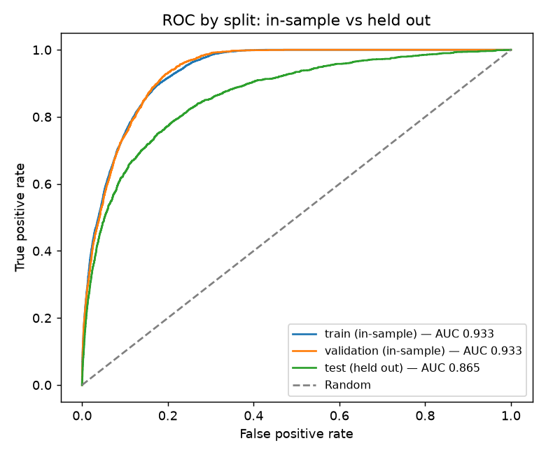

# Model evaluation

All figures below were produced by running `python -m ml.train` and
`python -m ml.evaluate --cross-validate` against the downloaded
`cs-training.csv`. They are copied from `backend/ml/artifacts/metadata.json`
and `evaluation_report.json`, both regenerated on every run. Nothing here is
estimated or illustrative.

- Model: Random Forest delinquency classifier **v1.0.0**
- Algorithm: `RandomForestClassifier`, 300 trees, `min_samples_leaf=20`, no
  class weighting, **plus missing-value indicator columns**
- Seed 42; fitted on train + validation (120,000 rows)
- Evaluated on the held-out test split (30,000 rows), used exactly once
- **Decision threshold: 0.2302**, chosen on validation (see below)

## Class distribution

| Split | Rows | Negative | Positive | Positive rate |
|---|---:|---:|---:|---:|
| Train | 90,000 | 83,984 | 6,016 | 6.68% |
| Validation | 30,000 | 27,995 | 2,005 | 6.68% |
| Test | 30,000 | 27,995 | 2,005 | 6.68% |

## The decision threshold

The conventional 0.50 cut-off is a poor fit for a 6.68% positive rate: it makes
the forest so conservative that it flags only 506 of 30,000 borrowers and
misses 85% of real delinquencies.

The threshold is therefore **selected, not assumed** — by maximising F1 on the
**validation** split, scored by the candidate fitted on *train only*. That
model never saw the validation rows, and the test split takes no part in the
choice, so the selection is honest.

| Threshold | Validation precision | Validation recall | Validation F1 |
|---|---:|---:|---:|
| **0.2302** (selected) | 0.4127 | 0.4703 | **0.4396** |
| 0.5000 (conventional) | 0.6290 | 0.1581 | 0.2527 |

The chosen value is stored in `metadata.json` and read by the API at startup,
so the threshold the service applies is always the one these metrics were
measured at. It is not duplicated in application config.

**Validation F1 0.4396 → test F1 0.4482.** The threshold transfers to unseen
data, which is the evidence that it was not over-fitted to the validation
split.

## Metrics on every split

The final model was refitted on train + validation, so **those two are
in-sample**; only `test` is a held-out estimate. All three are shown because
the difference between them is the point.

| Metric | Train (in-sample) | Validation (in-sample) | **Test (held out)** |
|---|---:|---:|---:|
| Accuracy | 0.9264 | 0.9265 | **0.9199** |
| Precision | 0.4580 | 0.4565 | **0.4153** |
| Recall | 0.5472 | 0.5267 | **0.4868** |
| F1-score | 0.4986 | 0.4891 | **0.4482** |
| ROC-AUC | 0.9329 | 0.9333 | **0.8654** |
| PR-AUC | 0.5232 | 0.5105 | **0.4014** |

### Confusion matrices (threshold 0.2302)

| Split | TN | FP | FN | TP |
|---|---:|---:|---:|---:|
| Train | 80,088 | 3,896 | 2,724 | 3,292 |
| Validation | 26,738 | 1,257 | 949 | 1,056 |
| **Test** | **26,621** | **1,374** | **1,029** | **976** |

Read the test row plainly: of 2,005 borrowers who really did become seriously
delinquent, the model **caught 976 and missed 1,029**. Of 27,995 who did not,
it wrongly flagged 1,374.

**The headline result is the test column: ROC-AUC 0.8654, PR-AUC 0.4014, F1
0.4482.** Quoting the train column would be reporting memorisation.

## Classification report (test split)

Per-class, the way scikit-learn's `classification_report` presents it:

| Class | Precision | Recall | F1 | Support |
|---|---:|---:|---:|---:|
| 0 — No serious delinquency | 0.9628 | 0.9509 | 0.9568 | 27,995 |
| 1 — Serious delinquency | 0.4153 | 0.4868 | 0.4482 | 2,005 |
| | | | | |
| **Accuracy** | | | **0.9199** | 30,000 |
| Macro avg | 0.6891 | 0.7189 | 0.7025 | 30,000 |
| Weighted avg | 0.9262 | 0.9199 | 0.9228 | 30,000 |

This table is the clearest illustration of why a single number misleads here:

- On **class 0** the model is excellent — F1 0.9568.
- On **class 1**, the class the project exists to find, F1 is 0.4482.
- **Weighted average F1 is 0.9228**, because it is dominated by the 27,995
  negatives. It looks superb and tells you almost nothing.
- **Macro average F1 is 0.7025**, treating both classes as equally important —
  a fairer summary.

If a single headline number is required, use **macro avg F1 (0.7025)** or the
**positive-class F1 (0.4482)**, and never the weighted average.

## Generalisation gap

Train minus test, on each metric:

| Metric | Gap |
|---|---:|
| Accuracy | +0.0065 |
| Precision | +0.0427 |
| F1 | +0.0504 |
| Recall | +0.0604 |
| ROC-AUC | **+0.0675** |
| PR-AUC | **+0.1218** |

**The model still overfits.** ROC-AUC drops 0.0675 from in-sample to held out,
and PR-AUC drops 0.1218 — a quarter of its in-sample value. `min_samples_leaf=20`
reduced this (the depth-unlimited baseline scored worse on validation across
the board) but did not eliminate it. 300 trees on 120,000 rows retain ample
capacity to memorise.

Note that accuracy barely moves (+0.0065) while PR-AUC collapses. Accuracy is
insensitive to overfitting here for the same reason it is insensitive to
everything else: it is dominated by the 93% majority class.



## Cross-validation

A single test score comes from one particular 30,000-row partition. Stratified
5-fold cross-validation on train + validation (120,000 rows, test excluded
throughout, same 0.2302 threshold) checks whether that score is stable:

| Fold | ROC-AUC | PR-AUC | Precision | Recall |
|---|---:|---:|---:|---:|
| 1 | 0.8616 | 0.3841 | 0.3938 | 0.4589 |
| 2 | 0.8733 | 0.4231 | 0.4345 | 0.4963 |
| 3 | 0.8591 | 0.3858 | 0.4007 | 0.4794 |
| 4 | 0.8628 | 0.4059 | 0.4138 | 0.4832 |
| 5 | 0.8591 | 0.3899 | 0.4042 | 0.4785 |

| Metric | CV mean | Std | Min | Max | Test |
|---|---:|---:|---:|---:|---:|
| Accuracy | 0.9189 | 0.0023 | 0.9166 | 0.9232 | 0.9199 |
| Precision | 0.4094 | 0.0141 | 0.3938 | 0.4345 | 0.4153 |
| Recall | 0.4792 | 0.0120 | 0.4589 | 0.4963 | 0.4868 |
| F1 | 0.4415 | 0.0130 | 0.4238 | 0.4633 | 0.4482 |
| ROC-AUC | **0.8632** | 0.0053 | 0.8591 | 0.8733 | **0.8654** |
| PR-AUC | **0.3978** | 0.0148 | 0.3841 | 0.4231 | **0.4014** |

**Every test metric falls within one standard deviation of its CV mean.** The
held-out estimate is not an outlier, and the spread across folds is small —
this performance is a property of the data and configuration, not of one
fortunate split.

Caveat: each fold trains on 96,000 rows against the final model's 120,000, so
CV runs very slightly pessimistic.

## Why accuracy is the wrong headline

Accuracy is 0.9199. A model that ignores its inputs and always predicts "no
delinquency" scores **0.9332** on the same test set — *higher*. Tuning the
threshold to catch delinquencies deliberately **lowered** accuracy from 0.9374
to 0.9199, while tripling recall (0.1566 → 0.4868).

That is the correct trade for this problem, and it shows why accuracy must not
drive the decision.

The metrics that carry information:

- **ROC-AUC 0.8654** — given one delinquent and one non-delinquent borrower at
  random, the model ranks the delinquent one higher 86.5% of the time.
- **PR-AUC 0.4014** — against a no-skill baseline of 0.0668 (the positive
  rate), a 6× improvement. This is the honest headline for a rare
  positive class, and it is what the model was selected on.

## Threshold trade-off

The same trained model at different cut-offs. "Flagged" is how many of the
30,000 test borrowers are marked positive.

| Threshold | Accuracy | Precision | Recall | F1 | Flagged |
|---:|---:|---:|---:|---:|---:|
| 0.1000 | 0.8469 | 0.2610 | 0.7047 | 0.3810 | 5,413 |
| 0.2000 | 0.9131 | 0.3884 | 0.5222 | 0.4454 | 2,696 |
| **0.2302 (in use)** | **0.9199** | **0.4153** | **0.4868** | **0.4482** | **2,350** |
| 0.3000 | 0.9292 | 0.4650 | 0.3970 | 0.4283 | 1,712 |
| 0.5000 | 0.9374 | 0.6267 | 0.1566 | 0.2506 | 501 |

Reading the table:

- Dropping to 0.10 pushes recall to 0.7047 — catching 1,413 of 2,005
  delinquencies — but precision falls to 0.2610, so three in four flagged
  borrowers are false alarms.
- The selected 0.2302 sits near the F1 optimum, balancing the two.
- At 0.50 the model is right 63% of the time when it flags someone, but only
  flags 501 people and misses 1,692 delinquencies.

Accuracy rises monotonically with the threshold purely because the model
predicts the majority class more often — which is exactly why it is a poor
guide.

### False positives versus false negatives

The two errors are not symmetric, and the dataset cannot tell us the exchange
rate between them. At the selected threshold:

- **1,374 false positives** — borrowers flagged as likely to become seriously
  delinquent who did not. In a real lending context the cost is a declined or
  repriced application: lost business, and a denied borrower who would have
  paid.
- **1,029 false negatives** — missed delinquencies. The cost is the loss on the
  credit extended.

In consumer lending the loss on a defaulted loan usually far exceeds the
foregone margin on a declined one, which argues for an even lower threshold
than 0.2302 and more tolerance for false alarms. Setting it properly requires
loss-given-default and margin figures the dataset does not contain, so this
project optimises F1 — which weights the two errors equally — and documents
that as an assumption rather than a finding.

## Class weighting

`class_weight="balanced"` and `"balanced_subsample"` were both evaluated on the
validation split:

| Candidate | Val ROC-AUC | Val PR-AUC | Val precision | Val recall |
|---|---:|---:|---:|---:|
| baseline (depth-unlimited) | 0.8450 | 0.3481 | 0.5334 | 0.1870 |
| regularised | 0.8615 | 0.3820 | 0.5988 | 0.1556 |
| balanced | 0.8602 | 0.3776 | 0.2399 | 0.7197 |
| balanced_subsample | 0.8602 | 0.3780 | 0.2805 | 0.6504 |
| **regularised + indicators (selected)** | **0.8630** | **0.3863** | 0.6290 | 0.1581 |

Class weighting raises recall dramatically (0.1556 → 0.7197) and lowers
precision just as dramatically — but leaves PR-AUC and ROC-AUC essentially
unchanged. It moves the model *along* the precision/recall curve rather than
improving the curve.

That is the same thing a threshold does, so the unweighted model was kept and
the operating point set explicitly by threshold selection instead. The
advantage: the threshold is visible in the metadata, adjustable without
refitting, and chosen by a documented criterion on a documented split.

Two changes did genuinely improve the curve:

- **`min_samples_leaf=20`** — the default full-depth forest overfits, costing
  0.034 PR-AUC against the regularised version.
- **Missing-value indicators** — +0.0043 validation PR-AUC over the same
  configuration without them, enough to win selection. See below.

## Missing-value indicators

The pipeline appends a binary "this value was missing" column for each feature
that had missing values in training, giving the forest **16 input columns**
from the 10 input features. The request schema is unchanged: the indicators are
derived inside the pipeline, so the API still accepts exactly the ten dataset
columns.

The motivation is that missingness here is **not random**. The 269 rows whose
delinquency counters were coded 96/98 are **54.65% positive** against a 6.68%
base rate. Imputing them to the median tells the model those borrowers had a
clean payment record; the indicator lets it know the value was absent.

Measured effect on the held-out test split:

| Metric | Without indicators | **With indicators** | Change |
|---|---:|---:|---:|
| PR-AUC | 0.3980 | **0.4014** | +0.0034 |
| F1 | 0.4404 | **0.4482** | +0.0078 |
| Precision | 0.4008 | **0.4153** | +0.0145 |
| Accuracy | 0.9170 | **0.9199** | +0.0029 |
| Recall | 0.4888 | 0.4868 | −0.0020 |
| ROC-AUC | 0.8656 | 0.8654 | −0.0002 |

**This is a real but modest gain.** PR-AUC and F1 improve, ROC-AUC is
unchanged, and recall is flat — the model became slightly more precise rather
than fundamentally better. It was adopted because it won the validation
comparison on the stated selection metric, not because it transformed the
result. It also reduced the overfitting gap slightly (PR-AUC gap 0.1317 →
0.1218).

## Probability calibration

**Calibration has not been evaluated.** The reported probability is the share
mean of the per-tree class probabilities: each tree reports the proportion of
the positive class in the leaf a borrower falls into, and the forest averages
those. It is a useful *ranking* score — ROC-AUC
0.8654 says so — but a predicted 0.30 should not be read as "30 out of 100 such
borrowers will become delinquent". Random Forest probabilities are typically
poorly calibrated, tending to avoid the extremes.

The API and UI therefore describe the output as an *estimated probability* and
never as a calibrated or real-world one. Producing calibrated outputs would
need `CalibratedClassifierCV` plus a reliability diagram and Brier score; that
is listed as future work, not done.

## Feature importance

Mean impurity decrease, from the fitted forest:

| Rank | Feature | Importance |
|---:|---|---:|
| 1 | `NumberOfTimes90DaysLate` | 0.2672 |
| 2 | `RevolvingUtilizationOfUnsecuredLines` | 0.2076 |
| 3 | `NumberOfTime60-89DaysPastDueNotWorse` | 0.1361 |
| 4 | `NumberOfTime30-59DaysPastDueNotWorse` | 0.1096 |
| 5 | `DebtRatio` | 0.0688 |
| 6 | `age` | 0.0581 |
| 7 | `MonthlyIncome` | 0.0538 |
| 8 | `NumberOfOpenCreditLinesAndLoans` | 0.0448 |
| 9 | `NumberRealEstateLoansOrLines` | 0.0172 |
| 10 | `NumberOfDependents` | 0.0147 |
| 11 | `missingindicator_NumberOfTime30-59DaysPastDueNotWorse` | 0.0064 |
| 12 | `missingindicator_NumberOfTime60-89DaysPastDueNotWorse` | 0.0062 |
| 13 | `missingindicator_NumberOfTimes90DaysLate` | 0.0062 |
| 14 | `missingindicator_MonthlyIncome` | 0.0028 |
| 15 | `missingindicator_NumberOfDependents` | 0.0004 |
| 16 | `missingindicator_age` | 0.0000 |

The indicator columns rank last, which is worth reading carefully rather than
as "they did nothing". Impurity importance measures how much total impurity a
feature removes across the whole forest, so a flag that is set on 269 of
150,000 rows can only ever accumulate a tiny share — however decisive it is on
those rows. The indicators improved validation PR-AUC enough to win selection
despite scoring 0.0064 and below here. `missingindicator_age` is 0.0000 because
exactly one training row triggers it.

**These are not causal statements.** Impurity-based importance says what the
trees chose to split on, which is not the same as what drives delinquency:

- It is **biased toward high-cardinality features**. The continuous ratios
  offer far more possible split points than a counter that is 0 for most
  borrowers, which inflates their apparent importance.
- It is computed on **training** data and rewards splits that may not
  generalise.
- Correlated predictors **split the credit** between them, so the three
  past-due counters each look less important than past-due behaviour as a whole
  really is. Together they account for 0.5129 — by far the dominant signal.
- Rare binary flags are **structurally understated**, as the indicators above
  show.
- Nothing here licenses a claim like "having dependents causes delinquency".
  Permutation importance on the test split would be more trustworthy; it has
  not been computed.

## Figures

Written to `backend/ml/artifacts/figures/` by `ml.explore` and `ml.evaluate`:

| File | Shows |
|---|---|
| `target_distribution.png` | Class imbalance in the raw data |
| `feature_distributions.png` | Four feature histograms (top 1% clipped for display) |
| `correlation_heatmap.png` | Pearson correlations, predictors and target |
| `test_curves.png` | ROC and precision-recall curves on the test split |
| `roc_by_split.png` | ROC for train, validation and test on one axis — the generalisation gap |
| `confusion_matrix.png` | Test confusion matrix at the selected threshold |
| `feature_importance.png` | The importances tabulated above |

## Interactive charts in the web app

Two charts were added to the frontend. Each exists because a table cannot show
what it shows; the ones that would only repeat a number (ROC curve, confusion
matrix heatmap, class-balance chart) were deliberately left out.

| Chart | Page | What a table cannot show |
|---|---|---|
| Score separation | Model info, Results | How far the two outcome groups' predicted scores overlap. This is the reason recall is capped, rather than only the fact that it is. |
| Threshold curve | Model info | The *shape* of the precision/recall trade-off: where F1 peaks, how flat the peak is, and where precision and recall cross. |

**Score separation** draws each actual outcome group as a share of its own
total. Negatives outnumber positives about 14 to 1, so raw counts would flatten
the positive group into the axis. On the Results page the same chart carries a
marker for the borrower just scored, so a single probability is shown against
the population it came from. Hovering a bin gives the absolute counts, which
the share-based drawing hides.

**Threshold curve** hover converts rates into people: at a given cut-off, how
many of the 2,005 delinquencies are caught and how many sound borrowers are
wrongly flagged. That is the question a decision-maker actually has, and the
four-row table cannot answer it at arbitrary thresholds.

The curve stops where the model flags fewer than 20 borrowers. Beyond that,
precision is computed from a handful of cases and swings between 0 and 1,
which would read as signal on a chart when it is noise.

Both charts are hand-drawn SVG with no charting dependency. Colours were checked with a colour-vision-deficiency validator. The two-series score chart (indigo, amber) has a worst adjacent pair of ΔE 34.0 under protanopia and 39.8 under normal vision. The three-line threshold chart adds teal, which lowers the worst pair to ΔE 12.5 under protanopia and 24.3 under normal vision; all steps are at least 3:1 contrast on white. That is above the validator's target of 8, and each line is also labelled directly, so identity never depends on colour alone.
**On phones.** Each chart is drawn at its real pixel width rather than scaled
down from one fixed drawing, so a 12px label stays 12px. Scaling a 720-unit
drawing to a 375px screen shrinks the text to about 5px, which is unreadable.
Tick counts drop on narrow charts so neighbouring labels never collide, and
touch works: tapping or dragging a finger across a chart opens the same
tooltip as hovering, while a vertical drag still scrolls the page.

The data comes from `/model-info` (`test_score_distribution` and
`test_threshold_curve`), generated by `ml/train.py` alongside the metrics.

## Reproducing

```bash
cd backend
python -m ml.explore                   # inspection + EDA figures
python -m ml.train                     # fits, selects config + threshold, saves artifact
python -m ml.evaluate                  # per-split metrics, gap, classification report
python -m ml.evaluate --cross-validate # the above plus 5-fold CV (refits 5 times)
```

`ml.evaluate` loads `model.joblib` from disk and recreates the identical splits
from the seed stored in `metadata.json`, so its numbers match the tables above
exactly. It imports no training logic except the candidate definitions needed
to refit for cross-validation, which doubles as a check that the saved artifact
is self-contained.
