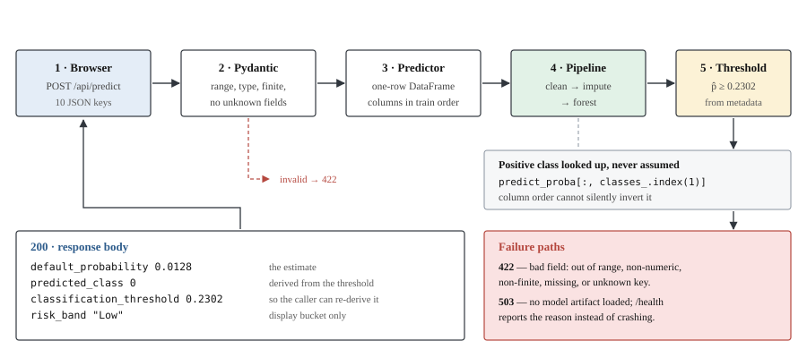

# Architecture

How the code is organised, what happens during a request, and the design
decisions worth knowing before changing anything.

## System shape

Two deployed pieces and one artifact.


The browser only ever talks to one origin. The frontend rewrites `/api/*` to
the backend server-side, so no cross-origin request is ever made and CORS
cannot apply. The backend keeps a CORS allow-list anyway as a second layer —
see [Deployment](08-deployment.md).

## Repository layout

```
LoanDefault/
├── backend/
│   ├── app/                      FastAPI service
│   │   ├── main.py               app, CORS, lifespan model load
│   │   ├── api/
│   │   │   ├── routes.py         endpoints only — no model logic
│   │   │   └── errors.py         JSON-safe 422 for non-finite input
│   │   ├── core/
│   │   │   ├── config.py         settings, risk bands, fallback threshold
│   │   │   └── model_registry.py holds the single Predictor instance
│   │   ├── schemas/prediction.py Pydantic request/response models
│   │   └── services/predictor.py the only code that touches the pipeline
│   ├── ml/                       offline: training and evaluation
│   │   ├── dataset.py            schema contract + loading
│   │   ├── preprocessing.py      cleaner + pipeline builder
│   │   ├── splits.py             deterministic 60/20/20
│   │   ├── metrics.py            metrics + safe predict_proba lookup
│   │   ├── artifacts.py          artifact save/load
│   │   ├── explore.py            data inspection + EDA figures
│   │   ├── train.py              training entry point
│   │   ├── evaluate.py           per-split report, gap, cross-validation
│   │   └── artifacts/            model.joblib, metadata.json, figures/
│   ├── tests/                    61 tests
│   ├── requirements.txt          runtime only — what the host installs
│   └── requirements-dev.txt      + training, plotting, tests
├── frontend/src/
│   ├── components/               Layout, ui, NumberField, ProbabilityBar
│   │   └── charts/               hand-rolled SVG charts, no chart library
│   ├── hooks/                    useAsync, usePrediction, usePredictionForm
│   ├── pages/                    Dashboard, Predict, Result, ModelInfo
│   ├── services/                 api.ts, featureFields.ts
│   └── types/api.ts              mirrors the backend response models
├── documentation/                this folder
├── dev/                          deck, report, brief, build scripts
└── data/raw/GiveMeSomeCredit/    git-ignored; download from Kaggle
```

## The layering rule

Each layer may only talk to the one below it.

| Layer | Knows about | Must not |
|---|---|---|
| `api/routes.py` | the predictor service | load artifacts or build frames |
| `services/predictor.py` | the pipeline, the metadata | know about HTTP |
| `ml/` | pandas and scikit-learn | know about FastAPI |

The practical effect: `routes.py` contains no model code, and `ml/` can be run
as scripts with the web framework uninstalled. The test
`test_preprocessing.py` relies on this, and so does the deployment —
`requirements.txt` omits matplotlib, pytest and uvicorn entirely.

## Request lifecycle



Three details in that path are deliberate.

**The model loads once.** `app/main.py` loads the artifact in a FastAPI
lifespan handler, into `core/model_registry.py`. Routes reach it through a
dependency that returns 503 if it is absent. The app therefore starts even
with no trained model, and `/health` reports *why* rather than the process
dying on boot.

**The positive class is looked up, not assumed.** `ml/metrics.py` finds the
index of label `1` in `classes_` before reading `predict_proba`. Assuming
column 1 would silently invert every probability if the class order ever
changed.

**The threshold comes from the artifact.** It is chosen during training and
stored in `metadata.json`; `config.py` only holds a fallback for artifacts that
predate threshold selection. The served cut-off and the reported metrics
therefore cannot disagree.

## Why preprocessing lives inside the pipeline

The saved `model.joblib` is a scikit-learn `Pipeline`:

```
ImplausibleValueCleaner → SimpleImputer(median, add_indicator=True) → RandomForestClassifier
```

Inference loads that object and calls it. There is no second copy of the
cleaning or imputation logic on the serving side, so train/serve skew is
structurally impossible rather than merely avoided by discipline.

A consequence worth noting: the model receives **16 columns** built from the
**10 input features**, because the imputer appends a missing-value indicator
per feature that had gaps in training. The API schema is unchanged — the extra
columns are derived inside the pipeline and callers never see them.

## Frontend structure

| Concern | Where |
|---|---|
| HTTP calls | `services/api.ts` — the only module that calls `fetch` |
| Form metadata | `services/featureFields.ts` — labels, bounds, groups, keyed by dataset column name |
| Form state and validation | `hooks/usePredictionForm.ts` |
| Shared prediction result | `hooks/usePrediction.tsx` (React context) |
| Charts | `components/charts/` — plain SVG, no charting dependency |

`featureFields.ts` keys every field by its dataset column name, which is also
the JSON key the API expects, so the form cannot drift from the trained schema.

The charts measure their container and draw at real pixel size rather than
scaling a fixed drawing down, so a 12px label stays 12px on a phone. See
[Model evaluation](05-model-evaluation.md#interactive-charts-in-the-web-app)
for why each chart exists.

## Testing

61 tests under `backend/tests/`. The ones worth knowing about:

| Test file | Guards |
|---|---|
| `test_preprocessing.py` | the target can never enter the feature list; placeholder and implausible-value cleaning; split determinism and disjointness |
| `test_metrics.py` | metric arithmetic against hand-checked examples; `predict_proba` lookup under a **reversed** `classes_` order |
| `test_artifact.py` | the saved artifact loads and scores without importing training code |
| `test_api.py` | every endpoint, plus 422s for out-of-range, missing, non-numeric, non-finite and unknown fields |
| `test_evaluation.py` | per-split scoring; the test split never leaks into the refitting set |

Tests needing a trained model skip cleanly when `model.joblib` is absent, so
the suite runs on a fresh checkout.

```bash
cd backend && pytest
```
